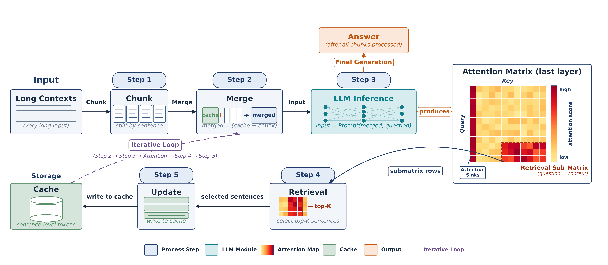
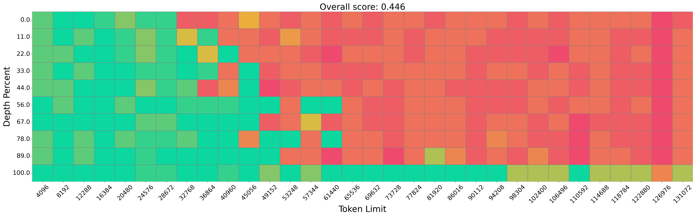
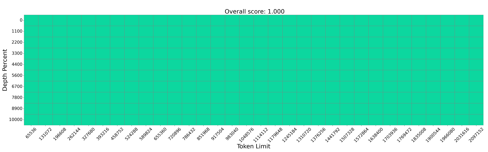
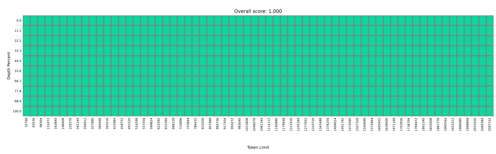
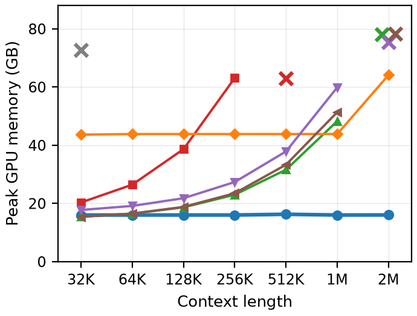
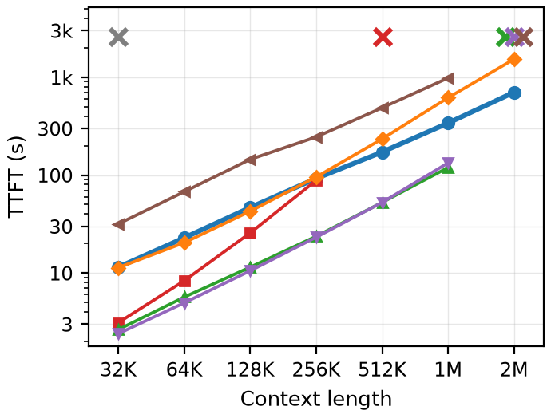
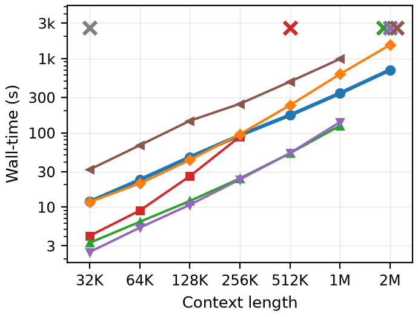
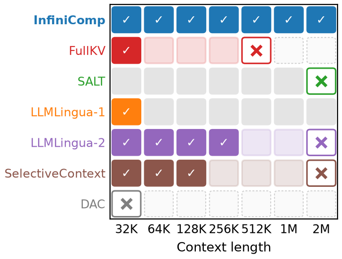
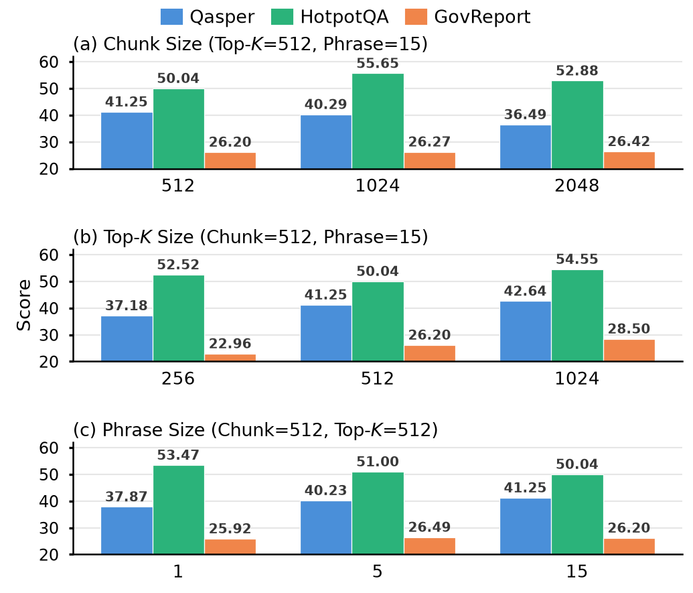

# InfiniComp: Training-Free Long-Context Retrieval via Attention-Aligned Retrieval

This is the anonymous code repository accompanying our paper under double-blind review.

**InfiniComp** is a *training-free* prompt-compression framework that lets off-the-shelf LLMs process **million-token contexts** on a single GPU. Instead of learned compressors or heuristic KV eviction, InfiniComp directly reads the model's own **last-layer question→context attention** as the retrieval signal (Attention-Aligned Retrieval, AAR): the attention the model already computes tells us exactly which sentences the question needs.



## How it works

1. **Chunk** — the long context is split into chunks at sentence boundaries.
2. **Merge** — each chunk is merged with the cached sentences (`merged = cache + chunk`).
3. **Forward** — the merged text and the question are fed to the LLM in a single forward pass.
4. **Retrieve** — from the last-layer attention matrix, the question × context sub-matrix selects the top-K most relevant sentences.
5. **Update cache** — the selected sentences are written back into a sentence-level cache. Steps 2–5 iterate over all chunks, and the final answer is generated from the (small) cache content.

Complexity is `O(mN)` (m chunks over N tokens) versus `O(N² + NM)` for full-KV inference, and the kept context stays at roughly **1,000 tokens regardless of input length**.

## Highlights

- **Training-free & model-agnostic** — no fine-tuning, no auxiliary compressor; works with Qwen2/2.5/3, Llama-3.1, Mistral, etc.
- **Constant memory** — peak GPU memory grows only **1.02×** from 32K to 2M tokens (15.97→15.99 GB for a 7B model), where FullKV runs OOM at 512K and all prompt-compression/KV baselines OOM by 2M.
- **Perfect needle retrieval at 2M tokens** — Qwen2.5-1.5B-Instruct answers every needle correctly up to 2M tokens; a 0.5B model reaches 1M tokens within 2 GB memory.
- **Strong downstream gains** — on LongBench v1, InfiniComp improves over the prior training-free prompt-compression SOTA (SALT) by **+20.6%** single-document QA, **+24.4%** multi-document QA, **+53.6%** code completion, **+19.7%** overall (Qwen2-7B, 512-token budget: 43.09 vs. 36.01).

## Results at a glance

### Needle-in-a-Haystack up to 2M tokens (Qwen2.5-1.5B-Instruct)

| FullKV | InfiniComp | InfiniComp (full 2M sweep) |
|---|---|---|
|  |  |  |

FullKV degrades beyond 32K tokens; InfiniComp answers correctly at every depth and every length up to 2M tokens.

### Efficiency (Qwen2.5-7B, single A800-80GB)

| Peak GPU memory | TTFT (incl. compression) | End-to-end wall-time | NIH outcome |
|---|---|---|---|
|  |  |  |  |


### Robustness to hyperparameters



## Repository structure

| Path | Description |
|---|---|
| `src/pipline.py` | Pipeline orchestrator: chunk → merge → retrieve → update → generate |
| `src/retrieval.py` | Core attention-based retrieval (last-layer question→context attention, exact eager / SDPA paths) |
| `src/chunks.py` | Sentence-boundary chunking of the long context |
| `src/text_split.py` | Sentence / text-unit splitting utilities |
| `src/thoughts.py` | Attention analysis & heatmap visualization |
| `src/run_longbench.sh` | One-click LongBench evaluation (all 16 tasks) |
| `src/metric/metric_LongBench.py` | LongBench v1 evaluation entry |
| `src/metric/metric_LongBenchV2.py` | LongBench v2 evaluation entry |
| `src/metric/metric_InfiniteBench.py` | ∞Bench evaluation entry |
| `src/metric/run_needle_in_haystack.py` | Needle-in-a-Haystack sweep (adapted from [Long-Context-Data-Engineering](https://github.com/FranxYao/Long-Context-Data-Engineering)) |
| `src/metric/efficiency_benchmark_NIH.py` | Memory / TTFT / wall-time efficiency benchmark |
| `src/metric/get_all_layers_recall.py` | Layer-wise attention recall analysis (observation experiments) |
| `docs/QuickStart_LongBench.md` | Detailed LongBench evaluation guide (Chinese) |

## Installation

```bash
# Python 3.10+, CUDA-capable PyTorch recommended
pip install -r src/requirements.txt
```

## Quick start

### 1. LongBench evaluation

InfiniComp reuses the official LongBench harness. Place it as a sibling of `src/`:

```bash
# from the repository root
git clone https://github.com/THUDM/LongBench metrics/LongBench
# download the LongBench data jsonl files into metrics/LongBench/data/
```

Then edit the **config section** at the top of `src/run_longbench.sh` (set `MODEL_PATH` to a local HF-format model directory or a HuggingFace model ID) and run:

```bash
bash src/run_longbench.sh --quick            # smoke test: 3 samples, one task
bash src/run_longbench.sh --task hotpotqa    # single task
bash src/run_longbench.sh                    # full 16-task evaluation
```

Predictions are written to `metrics/LongBench/pred/<config_tag>/` and each task is scored automatically.

### 2. Use InfiniComp as a library

```python
from pipline import Pipline

pipe = Pipline(config={
    "llm_name_or_path": "Qwen/Qwen2.5-7B-Instruct",
    "chunk_size": 512,               # tokens per chunk
    "compress_budget": 512,          # max tokens of the compressed context
    "topk_phrase": 100,              # top attention indices per retrieval step
    "phrase_token_num": 25,          # score granularity (tokens per phrase)
    "cache_granularity": "sentence-level",
})

data = {"context": <your long context>, "input": <your question>}
response, result_info = pipe.generate(data, prompt=None, task_name="hotpotqa")
```

### 3. Other benchmarks

| Experiment | Entry point | External harness |
|---|---|---|
| Needle-in-a-Haystack | `src/metric/run_needle_in_haystack.py` | clone [Long-Context-Data-Engineering](https://github.com/FranxYao/Long-Context-Data-Engineering) into `metrics/Needle-in-haystack` |
| Efficiency (memory/TTFT) | `src/metric/efficiency_benchmark_NIH.py` | same as above |
| LongBench v2 | `src/metric/metric_LongBenchV2.py` | LongBench v2 data |
| ∞Bench | `src/metric/metric_InfiniteBench.py` | ∞Bench data |

## Main hyperparameters

| Parameter | Meaning | Typical settings (paper) |
|---|---|---|
| `chunk_size` | tokens per chunk | 512 (LongBench) / 1024 (NIH) |
| `compress_budget` | upper bound of compressed context length (tokens) | 512 / 1000 (LongBench) |
| `topk_phrase` | top attention-score indices selected per retrieval step | 100–300 |
| `phrase_token_num` | score granularity: tokens per phrase | 8–25 |
| `iter_number` | retrieval iterations (helps multi-hop tasks) | 1 |
| `cache_granularity` | `sentence-level` (default) or `token-level` | sentence-level |
| `exact_eager` | `true`: bitwise-exact eager attention capture; `false`: fast SDPA path | true |

InfiniComp is robust to these choices: a generous `topk_phrase`/`compress_budget` is the most universally helpful knob, and the remaining parameters need at most light per-task tuning (see the ablation figure above and Section 4.5 of the paper).

## Citation

Anonymous submission. Citation information will be added upon publication.

## License

This repository is released for review purposes under the MIT License (copyright holder anonymized for double-blind review).
